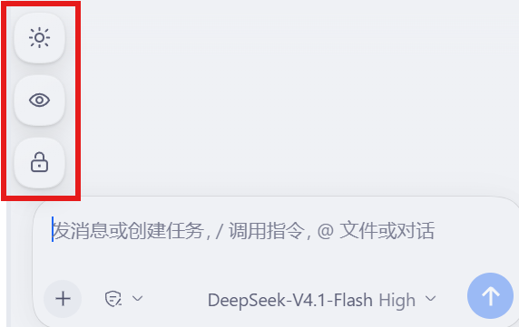

# 屏幕守护（Screen Guard）

> [!WARNING]
> **本插件尚处于半成品状态**，可能存在未发现的缺陷，请在了解风险后使用。
>
> **锁定状态会跨启动保留。** 插件本身不创建独立进程，会随 DSH 一同结束；但锁定标记保存在浏览器本地存储中，若在锁定状态下关闭 DSH，下次启动仍会停在解锁界面。
>
> **请务必牢记密码。** 本项目不提供找回流程：一旦遗忘，只能清除浏览器中该站点的数据（键名 `dsh.screen-guard.lock`）才能恢复界面。
>
> 因使用本插件产生的任何后果，由使用者自行承担，与本开发者无关。

为 DeepSeek Harness Web GUI 增加三个常驻开关：**保持屏幕常亮**、**一键遮住界面**、**密码锁屏**。

> 按钮在对话框上方左侧，竖向排列；鼠标悬停时标签从图标右侧滑出。



## 三个开关

| 按钮 | 作用 |
| --- | --- |
| ☀ **屏幕常亮** | 用浏览器 Wake Lock 让屏幕不因空闲休眠。开启后按钮变成浅暖色；点击时会有一圈光晕向外扩散 |
| 👁 **防窥遮罩** | 点一下：一条斜线自左上向右下划过屏幕，随后整屏被不透明遮罩盖住。在遮罩上单击或按 `Esc` 恢复 |
| 🔒 **密码锁屏** | 首次点击设置密码并立即锁定；之后点击直接锁定。锁定后必须输入密码才能恢复界面 |

## 密码

- **设置**：首次点锁图标，在弹出的小面板里输入两次密码（至少 4 位）
- **修改 / 清除**：**未锁定状态下右键**锁图标，先验证当前密码，然后可以改密码或清除
- **解锁**：锁屏界面输入密码，回车或点「解锁」

密码以 **SHA-256** 哈希（无 `crypto.subtle` 时退化为 FNV-1a）存在浏览器 `localStorage`，不存明文。

> ⚠️ 这挡的是"路过的人"，不是"能碰你电脑的人"：打开 DevTools 或清空站点数据都能绕过。要防本机操作者，用系统锁屏，不是网页插件。

## 与 DSH 进程的关系

**不创建任何独立进程。** 按钮、遮罩、密码校验全部运行在 DSH 自己的页面与其 Host 进程里，关闭 DSH 时一并结束，没有残留。

锁定状态会被记住：若关闭时仍锁定，下次打开 DSH 会直接停在解锁界面（否则刷新页面就能绕过）。

## 位置适配

按钮组在对话框上方的槽位里，按对话栏宽度自动切换：

- 对话栏较宽（≥ 1000px）：输入框两侧有留白，按钮组下移，贴在输入框左侧的空白里
- 对话栏较窄：输入框几乎顶到左边，按钮组停在输入框上沿之上

## 安装

前置：DSH 0.2.x（Web 或桌面版）。这个插件只有 Client 半，不需要额外服务。

```bash
git clone https://github.com/nm2jnpbmtc-dev/Screen-Guard-for-DeepSeekHarness.git
```

在 Harness 里二选一：

- 设置 → 插件 → 安装本地插件，选择克隆下来的目录
- 让 Agent 用 `plugin_manager` 的 `install_bundle` 安装该目录

装好后无需重启进程。若按钮没出现，刷新页面（`Ctrl + R`）。

## 实现

| 部分 | 做法 |
| --- | --- |
| 按钮组 | 注册到 `conversation.input.dock`（对话框上方整宽槽位），竖向排列，左对齐 |
| 悬停标签 | 绝对定位，`max-width` 从 0 展开 + 淡入，不占布局 |
| 常亮 | `navigator.wakeLock.request('screen')`，监听 `release` 与 `visibilitychange` 自动重申请 |
| 防窥 / 锁屏 | `shell.overlay` 框架级浮层，`position: fixed; inset: 0`，主题背景色 + 模糊 |
| 密码输入 | 原生 `<input>` 全透明（只负责接收键盘与输入法），显示由插件自绘：圆点 + 自定义闪烁插入符 |
| 样式 | 全部使用 `--dsw-alias-*` 主题 token，浅色/深色自动适配 |

## 已知边界

- Wake Lock 需要 Chromium 内核（Electron / Chrome）；不支持时开关置灰
- 页面切到后台时浏览器会释放锁，这是平台行为，回到页面会自动重新申请
- 自绘密码框牺牲了输入法候选框的定位；输入中文密码时体验一般（密码通常用 ASCII）
- 忘记密码只能清除该站点的 `localStorage`（键：`dsh.screen-guard.lock`）

## License

MIT
